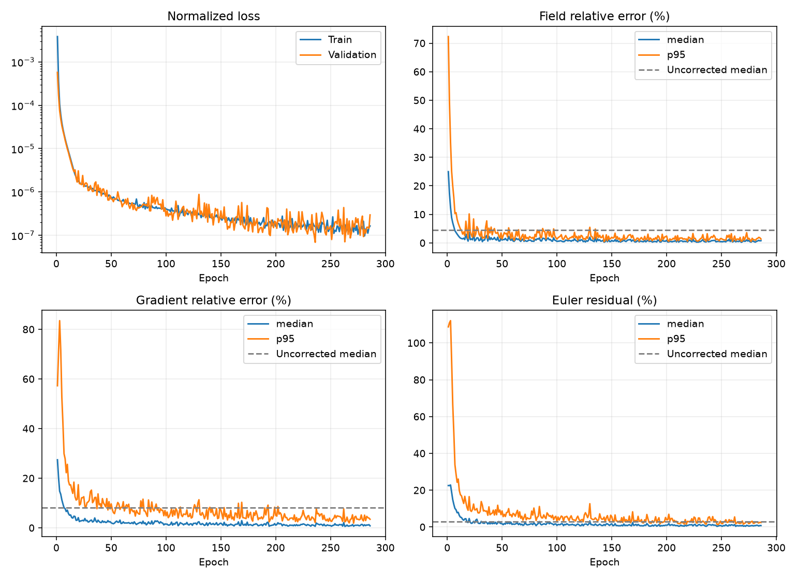
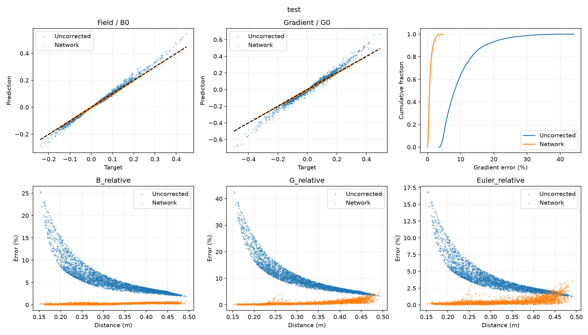

# MagFNN：用于偶极子磁场转换的前馈神经网络

本项目是“BP 神经网络拟合非线性函数”课程作业，研究如何从一阶偶极项与三阶八极项叠加的磁场观测中，预测同一位置的一阶磁场及梯度，为基于偶极模型的定位提供修正后的观测。

完整推导、训练曲线与结果分析见[课程报告](./用于偶极子磁场转换的神经网络（MagFNN）.md)。

## 方法

磁源采用固定中心、固定磁轴的轴对称 1+3 阶解析模型。网络输入为三个场分量、五个独立梯度分量及无量纲磁源参数，共 9 维；输出为一阶场与梯度的 8 个分量。位置用于生成标签和评价，磁源参数在本次数据中固定。

- 原规模网络：`9 → 64 → 64 → 64 → 8`，9,480 个参数。
- 缩减网络：`9 → 8 → 8 → 8 → 8`，296 个参数，减少约 96.9%。
- 隐藏层采用平滑非线性激活函数 SiLU，输出层为线性层。
- 采用 Adam 优化器，学习率 0.001、批量大小 512、随机种子 4098；最多训练 500 轮，验证损失连续 50 轮无改善则早停。
- 损失为归一化场分量均方误差与独立梯度分量均方误差之和，两类平均误差等权。

场除以参考场强 B0，梯度除以参考梯度 G0，完成无量纲化。利用梯度的对称性与零迹性质，从五个独立分量重建完整梯度矩阵。

## 数据

在 `x,y ∈ [−0.15,0.15] m`、`z ∈ [0.15,0.45] m` 内均匀采样 100,000 点，划分为训练集 80,000 点、验证集 10,000 点及测试集 10,000 点，另生成 1,331 点规则诊断网格。

磁源系数为 M1 = 93.56451259694958 A·m²、M3 = 0.287540068 A·m⁴，参考长度为 0.1 m。输入为一阶与三阶叠加观测，标签为解析一阶结果。生成器包含解析导数、对称无迹性质、欧拉关系及文件读写一致性检查。

## 主要结果

以下为同一无噪声测试集的结果。原规模模型采用首次训练的最佳检查点。

| 方法 | 参数量 | 场误差中位数 / P95 | 梯度误差中位数 / P95 |
|---|---:|---:|---:|
| 不做修正 | — | 4.596% / 12.428% | 8.198% / 21.853% |
| 原规模网络 | 9,480 | 0.320% / 0.569% | 0.608% / 2.182% |
| 宽度 8 网络 | 296 | 1.062% / 2.452% | 3.248% / 10.724% |

相对误差以一阶标签的范数为分母，场采用向量欧氏范数，梯度采用完整矩阵的 Frobenius 范数。P95 为第 95 百分位数，反映误差分布尾部。

原规模网络有效降低了高阶分量带来的误差。缩减网络仍有修正收益，但场与梯度中位误差分别增至原规模网络的约 3.3 倍和 5.3 倍。其最佳模型出现在第 497 轮，网络容量与后期优化进程共同构成后续分析重点。





报告还分析了原规模网络在三种噪声情景下的表现。单次采样时梯度中位误差为 37.428%，理想 1 秒开关均值情景下降至 2.519%，体现了输入测量质量对梯度转换的重要影响。实测数据融合、相关噪声与标定误差建模、多种子实验，以及转换结果对定位精度的影响，是后续研究方向。

## 安装与复现

使用 Python 3.13 和 uv，在仓库目录运行：

```bash
uv sync --locked
uv run --locked python generate.py
uv run --locked python -m unittest -v test_training_code.py
uv run --locked python train.py --output runs/baseline
```

训练默认使用 CPU，可用 `--device mps` 选择支持的 Mac GPU，或用 `--live` 显示实时曲线。跨设备、库版本及随机批次实现可能产生数值差异。

训练按验证损失选择最佳模型，再评价测试集和诊断网格。输出包含 `best.pt`、`last.pt`、配置、逐轮历史、训练曲线、评价指标与预测数组。输出目录须为空，重复实验请指定新目录。

单独评价原规模检查点：

```bash
uv run --locked python evaluate.py --checkpoint runs/baseline/best.pt --split test --output runs/test_review
```

复现网络规模实验：

```bash
uv run --locked python compare_capacity.py
```

该脚本依次训练宽度 64、32、16、8 的网络，保存验证损失历史、最佳权重及各集合指标，并生成规模实验摘要。课程报告重点讨论宽度 8 的结果。固定输出目录为 `runs/capacity_comparison/`，运行前该目录须不存在；脚本生成的检查点使用 `width` 字段记录结构，与 `evaluate.py` 的原规模检查点格式不同。

噪声分析入口为 `evaluate_noise.py`。它依赖仓库上级目录中的《传感器噪声与误差建模实验报告_20261107.md》，阵列几何已定义在脚本中，属于原工作区的扩展分析；独立克隆仓库后的数据生成与基本训练流程不依赖这些资料。

## 文件说明

| 文件 | 用途 |
|---|---|
| `generate.py` | 解析数据生成、划分与一致性检查 |
| `model.py` | 可配置隐藏层宽度的网络与损失函数 |
| `train.py` | 原规模网络训练及最终评价 |
| `evaluation.py` | 物理指标、推理和绘图 |
| `evaluate.py` | 原规模检查点独立评价 |
| `compare_capacity.py` | 网络宽度对照实验 |
| `evaluate_noise.py` | 基于原工作区资料的噪声敏感性分析 |
| `test_training_code.py` | 网络、指标、检查点与数据接口检查 |
| `用于偶极子磁场转换的神经网络（MagFNN）.md` | 课程报告 |
| `用于偶极子磁场转换的神经网络（MagFNN）.assets/` | 报告与 README 使用的图片 |

Git 保留源码、依赖锁文件、报告及展示图片。虚拟环境、缓存、`data/` 与 `runs/` 由 `.gitignore` 忽略，数据和训练产物可通过上述流程在本地生成。
