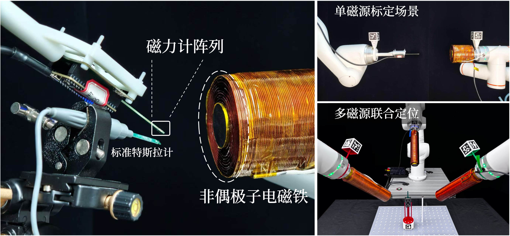
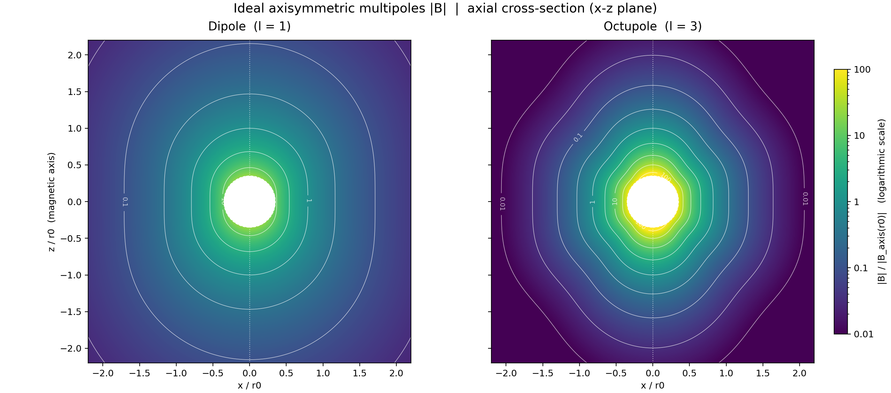
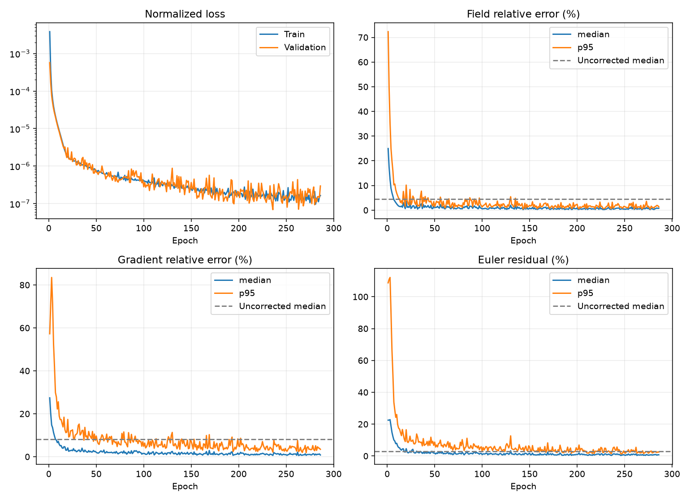
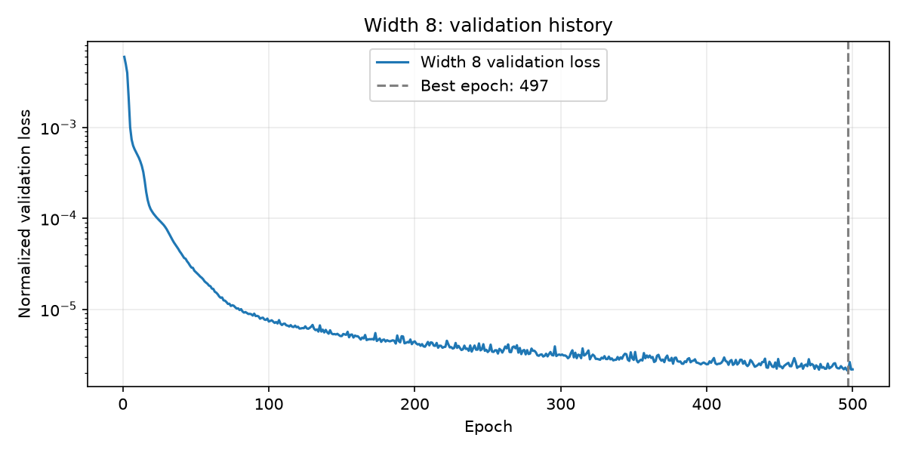
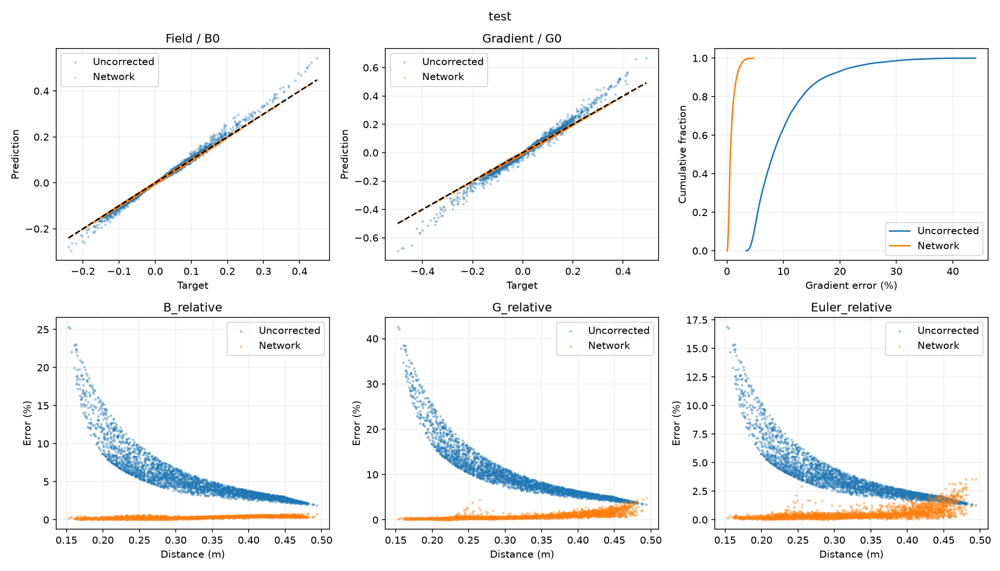
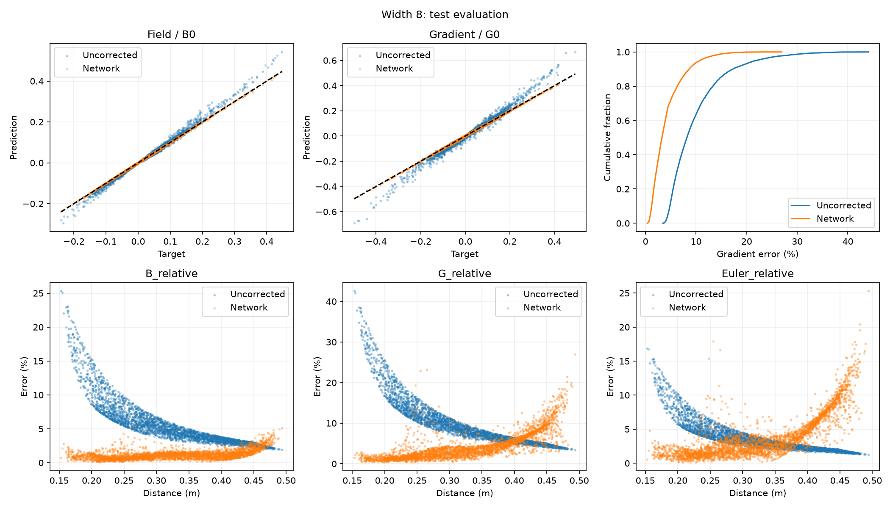
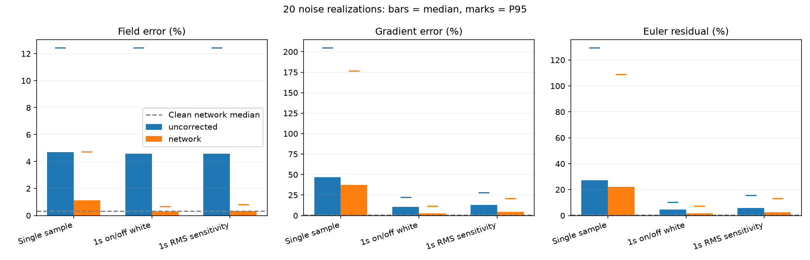

# 用于偶极子磁场转换的神经网络 MagFNN

普钰博 3120265616

**摘要** 本课程作业围绕“BP 神经网络拟合非线性函数”研究问题（作业题目一），对题目中拟合传感器测量非线性的问题稍加改进，结合实际科研问题，研究磁场测量中的高阶分量修正方法。本研究以一阶偶极项和三阶八极项叠加的解析磁场为输入，训练前馈神经网络（Feedforward Neural Network, FNN），预测同一位置的一阶磁场及梯度。原规模网络经过训练后，在无噪声测试集上的场和梯度中位相对误差分别为 0.320% 和 0.608%，低于直接使用混合场时的 4.596% 和 8.198%。将隐藏层宽度从 64 缩减至 8 后，两项误差分别升至 1.062% 和 3.248%，说明在当前训练条件下，过度压缩网络会降低拟合精度。实验进一步结合传感器噪声统计量分析测量扰动的影响，形成从理想拟合、网络规模到噪声敏感性的分析过程。

## 1 背景与问题定义

磁力计阵列可测量磁场及其空间梯度，为磁软体机器人的定位提供信息。理想偶极场具有简洁的解析关系，但在距离磁源较近时，高阶磁场分量可能不可忽略。因此，本文尝试学习从混合场到理想偶极场的转换，为后续定位提供修正后的观测量。

### 1.1 物理模型与符号

磁源采用轴对称多极展开，一阶项与三阶项共用展开中心和磁轴。设磁源中心为 $c$，观测位置为 $p$，磁轴单位向量为 $n$，定义相对位移 $\rho=p-c$、距离 $r=\|\rho\|$、方向 $u=\rho/r$，以及 $t=n^\mathsf{T}u=\cos\theta$，其中 $\theta$ 为观测方向与磁轴的夹角。第 $\ell$ 阶磁标势为

$$
\Psi_\ell=CM_\ell\frac{P_\ell(t)}{r^{\ell+1}},\qquad
B_\ell=-\nabla\Psi_\ell,\qquad
(G_\ell)_{ij}=\frac{\partial (B_\ell)_i}{\partial p_j}.
$$

其中，$C=\mu_0/(4\pi)=10^{-7}$，$\mu_0$ 为真空磁导率；$P_\ell$ 为 Legendre 多项式，$M_\ell$ 为多极系数，单位为 $\mathrm{A\,m^{\ell+1}}$。$B$ 为三维磁感应强度，单位为 T；$G$ 为其 $3\times3$ 空间梯度矩阵，单位为 T/m。本文使用 $P_1(t)=t$、$P_3(t)=(5t^3-3t)/2$，从解析势函数计算磁场和梯度。

一阶场为

$$
B_1=\frac{CM_1}{r^3}(3tu-n).
$$

第 $\ell$ 阶磁场随距离按 $r^{-(\ell+2)}$ 缩放，由欧拉齐次定理可得

$$
G_\ell\rho=-(\ell+2)B_\ell.
$$

因此，纯偶极场满足 $G_1\rho=-3B_1$；混合场 $B=B_1+B_3$、$G=G_1+G_3$ 则满足 $G\rho=-3B_1-5B_3$。高阶项衰减更快，但其混入会破坏纯偶极场的上述关系，增加基于偶极模型处理测量数据的误差。

### 1.2 学习目标

在磁源外部的均匀、无电流区域，梯度矩阵对称且迹为零，即 $G_{ij}=G_{ji}$、$G_{xx}+G_{yy}+G_{zz}=0$，因此只需五个独立梯度分量。网络学习映射

$$
f_\vartheta:\ (B_1+B_3,\ G_1+G_3,\ \beta)\longmapsto(B_1,G_1),
$$

其中 $\vartheta$ 表示网络可训练参数，$\beta$ 为下文定义的无量纲磁源参数。位置用于生成监督标签和计算物理评价指标，网络根据场与梯度观测完成转换。

## 2 数据与训练方法

### 2.1 数据集与归一化

取磁源中心为原点、磁轴为 $+Z$，传感器坐标轴固定，设置 $M_1=93.56451259694958\ \mathrm{A\,m^2}$、$M_3=0.287540068\ \mathrm{A\,m^4}$。在 $x,y\in[-0.15,0.15]$ m、$z\in[0.15,0.45]$ m 的立方体内均匀随机采样 100,000 点，划分为训练集 80,000 点、验证集 10,000 点和测试集 10,000 点，采样种子为 4098。另设包含边界和轴线的 $11^3=1,331$ 点规则网格，用于检查边界及轴线附近的预测效果。

取参考长度 $a=0.1$ m，定义 $B_0=CM_1/a^3$、$G_0=B_0/a$、$\beta=M_3/(M_1a^2)$。网络输入为

$$
X=(B_x/B_0,B_y/B_0,B_z/B_0,G_{xx}/G_0,G_{yy}/G_0,G_{xy}/G_0,G_{xz}/G_0,G_{yz}/G_0,\beta),
$$

标签 $Y$ 为相同顺序的八个一阶场与梯度分量。这一处理使输入和标签无量纲化，同时保留样本之间的幅值差异。完整梯度由对称性及 $G_{zz}=-G_{xx}-G_{yy}$ 重建。本次实验固定 $\beta$，对应同一磁源下不同空间位置的转换任务。

数据集由解析模型生成，使混合观测与一阶标签具有明确对应关系，便于分析网络对高阶分量的修正能力。磁源参数来源于已有拟合模型，其实测验证距离约为 0.105～0.253 m；本次采样进一步扩展到较远区域，以考察更大空间内解析映射的拟合效果。

### 2.2 网络结构与优化

原规模网络为 $9\rightarrow64\rightarrow64\rightarrow64\rightarrow8$，共 9480 个可训练参数。三个隐藏层使用平滑非线性激活函数 $\operatorname{SiLU}(z)=z/(1+e^{-z})$，输出层为线性层，直接预测八个分量，不设置残差旁路。BP 指通过误差反向传播计算参数梯度，本实验使用 Adam 优化器更新参数。

本研究中选择 SiLU 作为激活函数，因为它能够引入非线性的计算特性，且函数及其导数平滑，适合拟合本任务中随观测量连续变化的场与梯度映射。Adam 优化器利用梯度的一阶矩和二阶矩估计（分别反映梯度的平均趋势与平方幅度），为不同参数自适应调整更新步幅，便于在统一初始学习率下开展训练。两者分别提供平滑的非线性表达和自适应的参数更新方式，构成本实验的训练方案。

损失函数为归一化场与独立梯度分量的均方误差之和：

$$
L=\frac{1}{3N}\sum_{s=1}^{N}\sum_{j=1}^{3}(\widehat Y_{sj}-Y_{sj})^2
+\frac{1}{5N}\sum_{s=1}^{N}\sum_{j=4}^{8}(\widehat Y_{sj}-Y_{sj})^2,
$$

其中 $N$ 为批次样本数，$s$ 为样本编号，$j$ 为分量编号，帽号表示预测值。两类分量的平均误差等权相加，使训练同时关注场与梯度的拟合精度。

训练采用 float32、学习率 0.001、批量大小 512、随机种子 4098，最多 500 轮。训练具有早停策略，验证损失连续 50 轮未改善则停止，以最低验证损失选择模型，测试集不参与模型选择。原规模首次训练于第 286 轮停止，最佳模型位于第 236 轮。

缩减实验保留三个隐藏层、激活函数及主要训练设置，仅将各隐藏层宽度改为 8，得到 $9\rightarrow8\rightarrow8\rightarrow8\rightarrow8$，共 296 个参数，较原模型减少 96.9%。该网络训练至第 500 轮，最佳模型位于第 497 轮。两次训练采用相同的数据划分与主要超参数，分别完成参数初始化和随机批次采样。

图：原规模网络的训练与验证损失，以及验证集场误差、梯度误差和欧拉残差。横轴为训练轮次，P95 为第 95 百分位数，灰色虚线为不修正方法的中位误差。

图：宽度 8 网络的验证损失，纵轴采用对数刻度，虚线为所选最佳轮次。

### 2.3 评价指标

场与梯度的逐样本相对误差定义为

$$
e_B=\frac{\|\widehat B-B_1\|_2}{\|B_1\|_2},\qquad
e_G=\frac{\|\widehat G-G_1\|_F}{\|G_1\|_F}.
$$

$\|\cdot\|_2$ 为向量欧氏范数，$\|\cdot\|_F$ 为矩阵所有元素平方和的平方根。报告中位数与第 95 百分位数（P95，约 95% 的样本误差不超过该值），分别反映典型误差和误差分布尾部。另以

$$
e_E=\frac{\|\widehat G\rho+3\widehat B\|_2}{3\|B_1\|_2}
$$

衡量预测结果偏离偶极欧拉关系的程度。该指标从物理关系的一致性角度补充评价预测结果。对照方法是不做修正，直接将混合场和梯度作为一阶结果。

## 3 结果与分析

### 3.1 无噪声测试结果

以下数据来自同一 10,000 点测试集；原规模模型取首次训练结果。

| 方法 | 参数量 | 场误差中位数 / P95 | 梯度误差中位数 / P95 | 欧拉残差中位数 |
|---|---:|---:|---:|---:|
| 不做修正 | — | 4.596% / 12.428% | 8.198% / 21.853% | 3.064% |
| 原规模网络（宽度 64） | 9,480 | 0.320% / 0.569% | 0.608% / 2.182% | 0.359% |
| 缩减网络（宽度 8） | 296 | 1.062% / 2.452% | 3.248% / 10.724% | 2.619% |

原规模网络显著降低了混合场中的高阶分量误差。其验证集场与梯度中位误差分别为 0.323% 和 0.612%，与测试集接近，说明模型在这两个随机留出集合上的表现较为一致。诊断网格上的对应误差为 0.335% 和 0.705%，说明在包含边界的网格上仍保持较低误差。

缩减网络仍优于不做修正，但相对原规模网络，场与梯度中位误差约增至 3.3 倍和 5.3 倍，梯度 P95 由 2.182% 增至 10.724%。表明在本次训练预算下，将参数压缩至 296 个会带来明显精度损失，且梯度预测更为敏感。隐藏节点减少后，网络可组合的非线性特征随之减少，对场与梯度联合映射的刻画更为困难。同时，小网络的最佳结果出现在第 497 轮，接近训练上限，表明收敛过程也值得进一步考察。因此，误差上升可以从网络容量与优化进程两个方面理解，网络容量影响映射的表达能力，优化进程影响给定训练预算内能够达到的精度。延长训练并采用多个随机种子重复实验，有助于进一步区分两者的作用。

图：两种网络的测试集评估。上排前两图比较归一化预测分量与标签，黑色虚线为理想一致线；第三图为梯度相对误差的累积分布，表示误差不超过横轴数值的样本比例。下排展示场误差、梯度误差与欧拉残差随距磁源距离的分布。蓝色为不修正结果，橙色为网络结果；两图坐标范围可能不同，数值比较以表格为准。

### 3.2 噪声敏感性

为考察测量扰动对转换效果的影响，噪声实验固定原规模最佳模型的参数，对加入噪声后的输入进行预测。实验依据真实传感器的测量数据，在 12 颗三轴传感器层面加入独立、零均值高斯扰动，再经阵列估计关系联合传播到场和梯度，保留传播后两者的相关性。每种情景重复 20 次；下表为同一测试位置在重复噪声实现下合并统计的中位误差。

| 噪声情景 | 不修正：场 / 梯度 | 原规模网络：场 / 梯度 |
|---|---:|---:|
| 单次采样 | 4.699% / 46.799% | 1.122% / 37.428% |
| 理想 1 秒开关均值 | 4.595% / 10.762% | 0.307% / 2.519% |
| 均值噪声放大敏感性情景 | 4.596% / 13.145% | 0.316% / 4.463% |

理想 1 秒开关均值场景中，假设励磁开启与关闭时的测量相互独立，分别平均 1s 采样中的各个样本数目；第三种情景依据拟合结果的均值差均方根（RMS）比例放大各轴均值噪声，用于敏感性分析。三种情景中，网络均降低了场与梯度的中位误差。单次采样时梯度误差仍达 37.428%，而理想均值情景下降至 2.519%，说明测量噪声是影响梯度转换精度的重要因素。梯度由空间上相邻传感器的场差估计，较小的阵列间距使场测量扰动在梯度计算中被放大；时间平均则通过减小随机扰动改善输入质量。

图：三种假设噪声情景下的场误差、梯度误差和欧拉残差。柱高表示中位数，短横线表示 P95，灰色虚线表示无噪声网络的中位数。

噪声建模采用实测各轴标准差描述扰动幅度，并以独立高斯分布和理想平均关系简化其统计特性。真实阵列中，跨轴及跨传感器相关性会改变场与梯度误差的传播，时间相关性与漂移会影响平均效果；标定偏差、阵列几何误差及有限间距带来的曲率误差也会形成额外误差来源。这些因素需要结合完整的同步采样和标定数据进一步建模，是从本次敏感性分析走向实测应用的关键。

## 4 结论与后续研究

本实验验证了前馈神经网络在固定解析磁源和限定空间内，将一阶与三阶混合观测转换为一阶偶极观测的可行性。原规模网络在无噪声测试集上取得较低误差；将隐藏层宽度压缩至 8 后，参数量大幅降低，但场和梯度精度均明显退化，体现了模型规模与拟合性能之间的权衡。

本次研究以固定磁源和姿态下的空间插值为起点，先建立可控的解析学习任务，再通过网络缩减和噪声扰动分析影响精度的因素。下一步需要将这一转换方法扩展到实测观测和定位求解中，考察场与梯度的修正如何传递到最终位置估计。

后续将结合具体科研场景，进一步开展研究：

1. 融合真实磁场与梯度测量，采用独立标定或高可信参考获得验证依据，检验解析模型偏差及仿真到实测的转换效果。

2. 建立更完整的传感器误差模型，估计跨传感器、跨轴及时序相关性，并纳入漂移、标定和阵列几何误差，再研究噪声增强训练。

3. 通过多个随机种子、延长缩减模型训练及系统调整宽度，区分优化不足与容量限制，评估精度、参数量和实际推理耗时的权衡。

4. 扩展磁源参数、姿态和空间划分，检验区域外泛化；探索欧拉关系及场—梯度导数一致性约束，并最终评价转换对定位误差的影响。
